# Análisis exploratorio

Generado: 2026-10-30T10:30:11 por `python -m src.reporting.eda`. No editar a mano; la interpretación va en `reports/eda_observaciones.md`.

Este análisis describe los datos. No se usa para elegir variables ni modelos: los conjuntos A, B y C de la sección 13.6 ya están predefinidos.

## Cifras clave

- Panel: 45 departamento–ejercicio, 2017–2025.

- Correlación de la mortalidad con la del ejercicio anterior: global +0.77, intra-departamento +0.43 (n = 40).

- Correlación de la intensidad con la del ejercicio anterior: global +0.99, intra-departamento +0.62 (n = 40).

- 4 de 24 pares variable climática–objetivo cambian de signo entre la correlación global y la intra-departamento: la global mezcla diferencias entre regiones.

- 15 departamento–ejercicio con |z| ≥ 1,5 en algún objetivo, en días con CI ≥ 1000 o en precipitación (tabla `reports/tables/eda_anios_extremos.csv`).

### Variables climáticas con mayor |r| intra-departamento — mortalidad (ejercicio completo, n = 45)

| variable | r_intra_departamento | r_intra_departamento_y_anio | r_global |
|---|---|---|---|
| Precipitación total (mm) | 0.54 | 0.35 | 0.05 |
| Días CI ≥ 1200 | 0.41 | 0.13 | 0.35 |
| Días CI ≥ 1100 | 0.4 | 0.08 | 0.28 |
| CI percentil 95 | 0.38 | -0.05 | 0.31 |
| Días CI ≥ 1000 | 0.38 | 0.11 | 0.46 |

### Variables climáticas con mayor |r| intra-departamento — intensidad (ejercicio completo, n = 45)

| variable | r_intra_departamento | r_intra_departamento_y_anio | r_global |
|---|---|---|---|
| Días CI ≥ 1200 | -0.32 | -0.44 | -0.05 |
| Días CI ≥ 1100 | -0.31 | -0.44 | -0.11 |
| Precipitación total (mm) | -0.3 | -0.4 | -0.43 |
| CI percentil 95 | -0.21 | -0.3 | -0.07 |
| Racha máx. CI ≥ 1200 | -0.2 | -0.28 | -0.16 |

`r_intra_departamento_y_anio` descuenta además la media de cada ejercicio (shocks comunes a los cinco departamentos). Si cae mucho respecto de `r_intra_departamento`, la asociación viene de años que afectan a todos los departamentos a la vez, y la información efectiva se parece más a 9 años que a 45 observaciones.

Con 45 observaciones, |r| < 0,29 no es distinguible de cero al 5 % (y menos aún tras comparar muchas variables).

## 1. Cobertura por estación y ejercicio

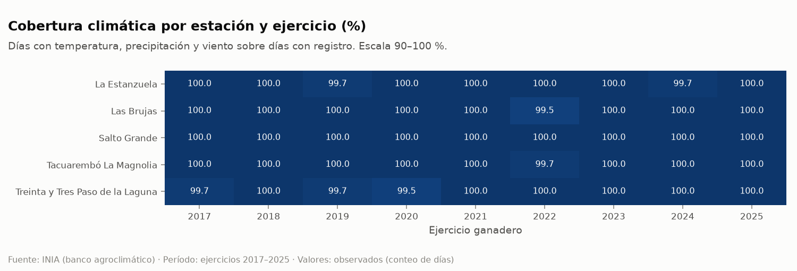

## 2. Faltantes de las variables climáticas requeridas

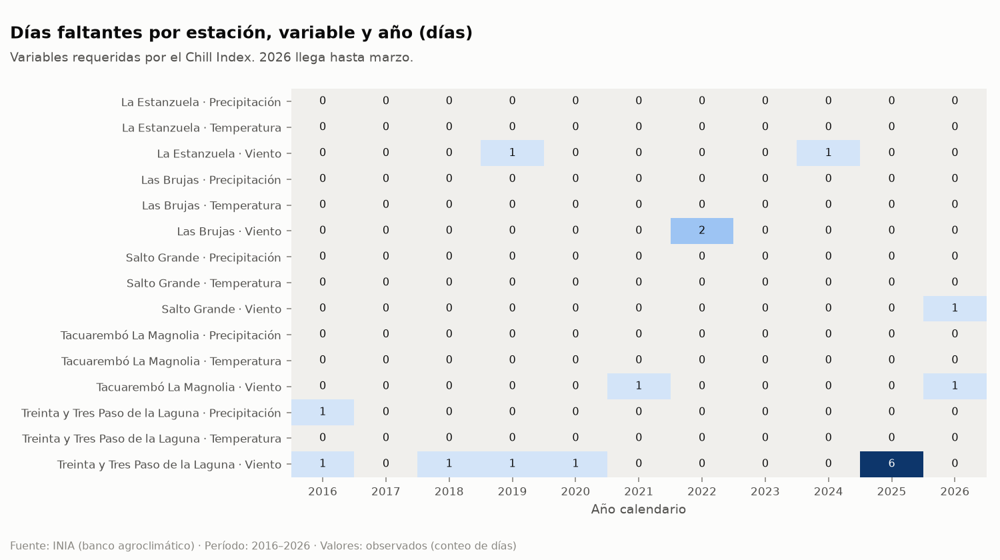

## 3. Intensidad ganadera

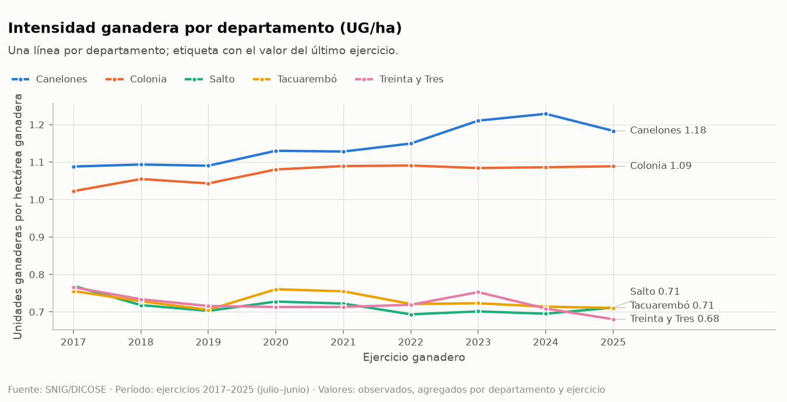

## 4. Mortalidad ovina por mil

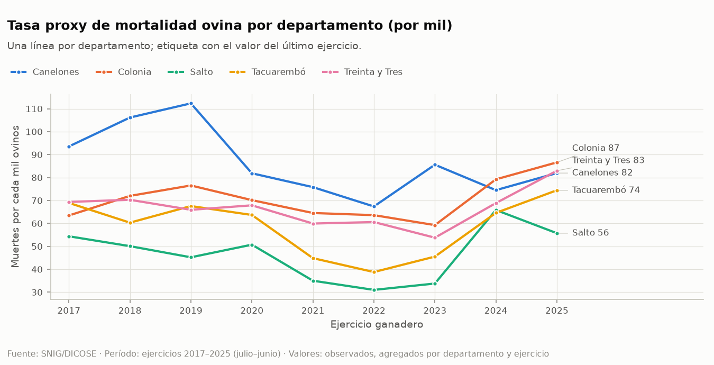

## 5. Stock y muertes por separado

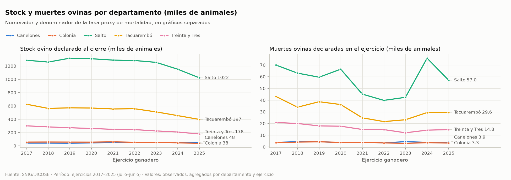

## 6. Distribución de la mortalidad por departamento

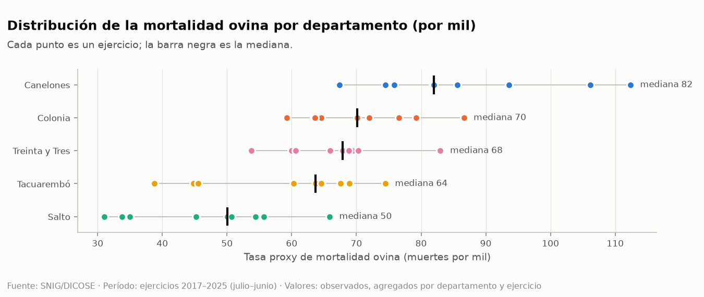

## 7. Días por categoría de Chill Index

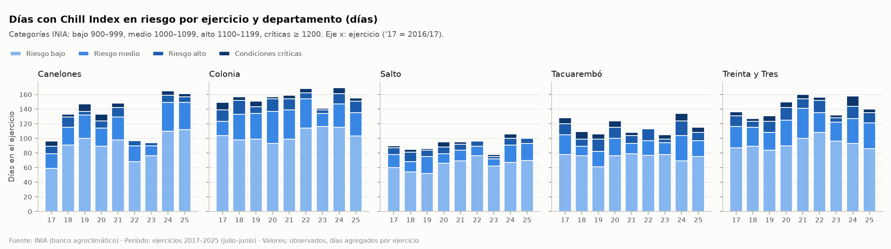

## 8. Precipitación y mortalidad

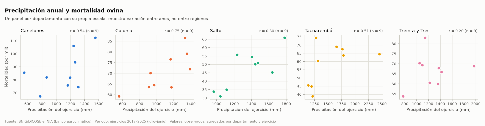

## 9. Días con CI ≥ 1000 y mortalidad

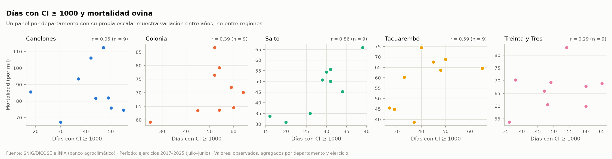

## 10. Días con CI ≥ 1200 y mortalidad

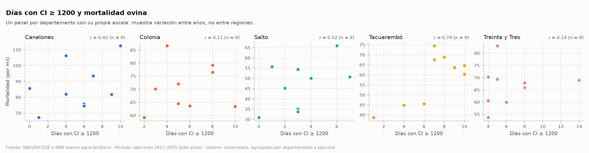

## 11. Correlaciones globales e intra-departamento

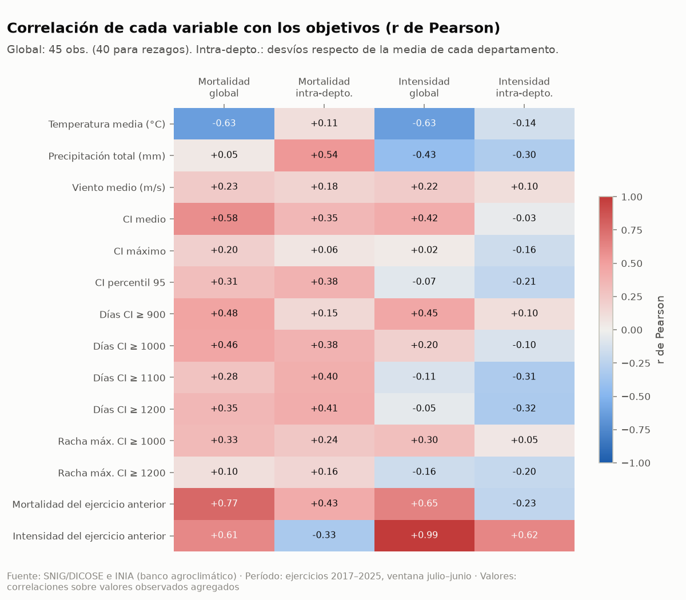

Por departamento (n = 9 cada uno): `reports/tables/eda_correlaciones_por_departamento.csv`.

## 12. Años extremos

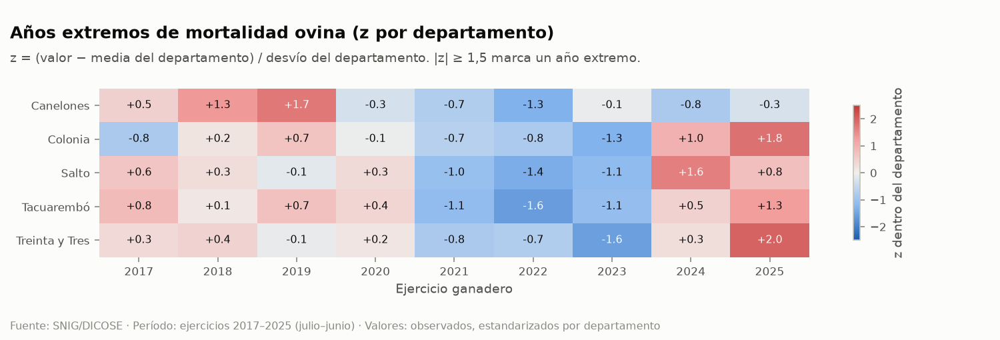

## 13. Ejercicio completo frente a julio–octubre

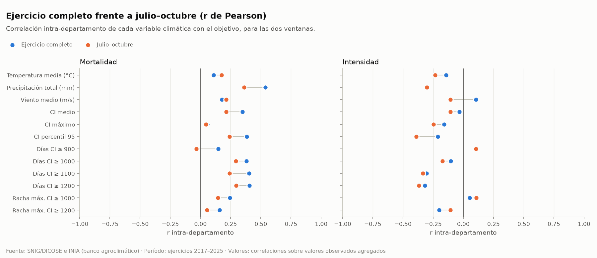

## 14. Observados frente a predicciones fuera de muestra

Generadas por `python -m src.models.run_models` (la corrida figura en el pie de cada imagen).

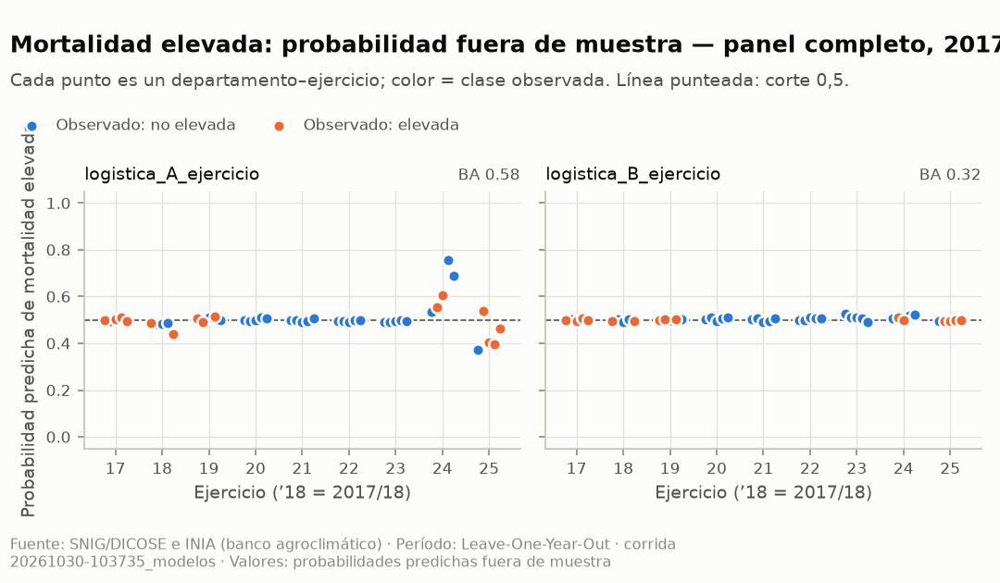

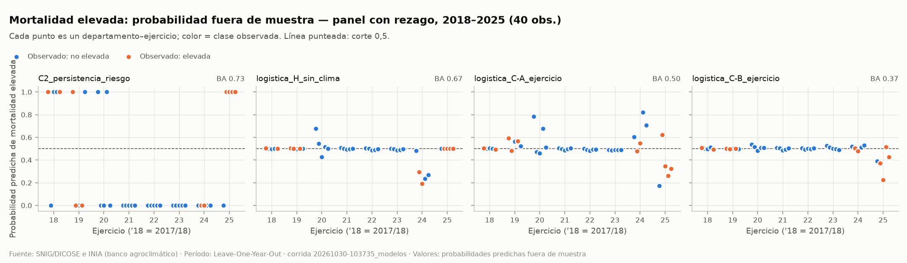

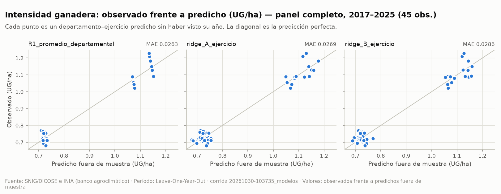

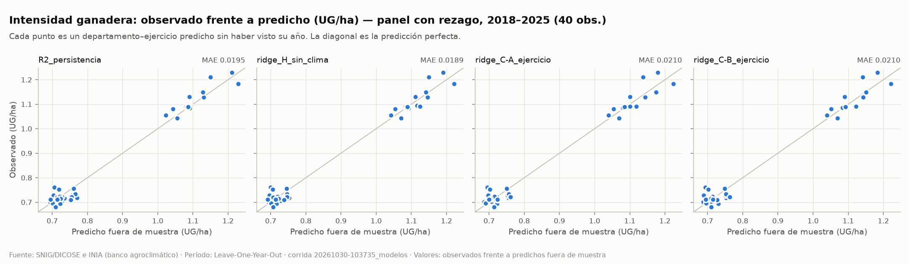
