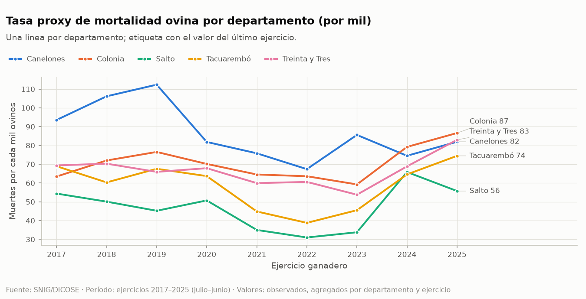
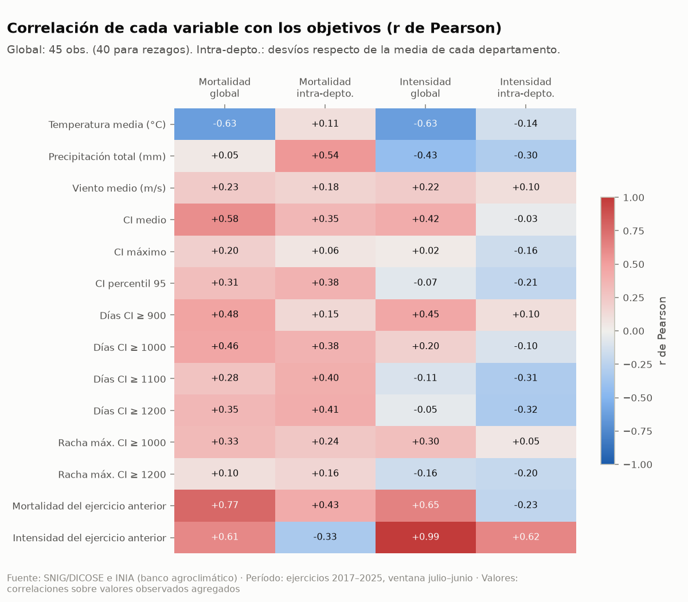
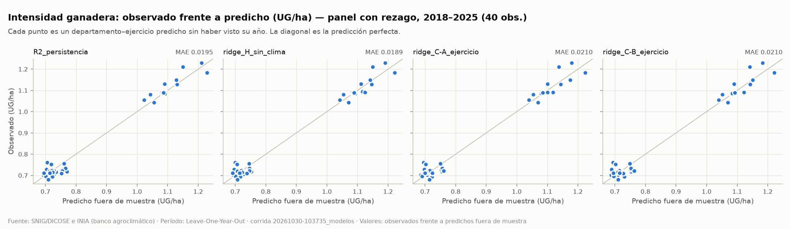
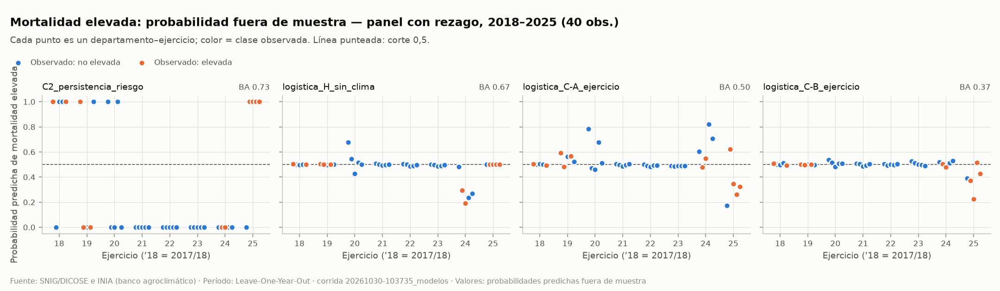

# Capacidad predictiva del Chill Index sobre la intensidad ganadera y la mortalidad ovina en Uruguay

**Informe final**

Luisa Gabriela Flores Piñeyro · Alejandra Daiana Ramírez Sempert · Alvaro Martin Barreto Tacoronte · Juan Pedro de León Sum
Universidad Tecnológica del Uruguay (UTEC) — Proyecto de Aprendizaje Automático, Licenciatura en Ingeniería de Datos e Inteligencia Artificial

Versión 1.0 · 30 de octubre de 2026 · Especificación metodológica v1.1

---

## Resumen

Evaluamos si las condiciones agroclimáticas, y en particular el **Chill Index** (índice de pérdida potencial de calor de INIA), aportan capacidad predictiva para dos objetivos:

- la **intensidad ganadera** (unidades ganaderas por hectárea);
- los ejercicios con **mortalidad ovina elevada**.

El estudio abarca cinco departamentos uruguayos con estación INIA (Canelones, Colonia, Salto, Tacuarembó y Treinta y Tres) en los ejercicios ganaderos 2017–2025. Integramos datos diarios de INIA con las declaraciones anuales DICOSE publicadas por SNIG en un panel de **45 observaciones independientes** (departamento × ejercicio). Validamos dejando afuera un ejercicio completo por vez (*Leave-One-Year-Out*) y comparamos contra baselines simples.

**Resultado:** ningún modelo climático supera a los baselines fuera de muestra, ni a un modelo que usa solo la historia propia de cada departamento.
- En intensidad, el mejor predictor es el valor del ejercicio anterior. Agregar clima empeora el error alrededor de 11 %.
- En mortalidad elevada, la regla "repetir la condición del año anterior" alcanza una balanced accuracy de 0,73. Los modelos climáticos quedan entre 0,32 y 0,58.

El análisis exploratorio explica por qué: la asociación clima–mortalidad existe, pero proviene casi por completo de **shocks comunes a los cinco departamentos en un mismo año**. Con nueve años de datos, eso equivale a muy poca información independiente para aprender.

Es un resultado negativo bien fundamentado. Con la resolución de datos disponible, el Chill Index anual no es un predictor útil de estos indicadores agregados.

---

## 1. Problema

La variabilidad climática puede afectar la actividad ganadera y la supervivencia de los ovinos. El frío, el viento y la lluvia aumentan la pérdida de calor de los animales, y el Chill Index resume esa exposición. INIA lo usa para alertar sobre el riesgo en corderos recién nacidos y en ovinos recién esquilados.

La pregunta del proyecto no es si se puede entrenar un modelo, sino:

> ¿Las variables climáticas aportan capacidad predictiva fuera de muestra por encima de la historia propia de cada departamento?

Para responderla, un modelo climático debe superar a referencias simples y difíciles de vencer: el promedio histórico del departamento y el último valor observado.

**Alcance.** El proyecto se plantea como una evaluación de capacidad predictiva, no como un sistema operacional de alerta.
- No se construye panel de visualización (sección 5.4 de la especificación). El resumen presentado a la JAI anticipaba un dashboard; el equipo decidió no construirlo en esta versión.
- Se analiza la mortalidad ovina, no la de otras especies.

## 2. Fuentes de datos

| Fuente | Contenido | Uso |
|---|---|---|
| INIA, banco de datos agroclimáticos | Datos diarios 2016-01-01 a 2026-03-17 de seis estaciones | Temperatura media, precipitación y recorrido del viento; cálculo del Chill Index |
| SNIG/DICOSE, `DatosAnimales` | 677.035 filas, 2016–2025 | Muertes y existencias ovinas |
| SNIG/DICOSE, `DatosGenerales` | 315.536 filas, 2016–2025 | Unidades ganaderas y superficie ganadera |

Asignación de estaciones:

| Departamento | Estación |
|---|---|
| Canelones | Las Brujas |
| Colonia | La Estanzuela |
| Salto | Salto Grande |
| Tacuarembó | La Magnolia |
| Treinta y Tres | Paso de la Laguna |

La estación Tacuarembó Glencore se excluyó: no alcanza la cobertura mínima en ningún ejercicio.

### 2.1 Calidad de datos

La auditoría automática (`reports/auditoria/auditoria_datos.md`) pasó los 22 chequeos con los que se verifican los hallazgos de la sección 9 de la especificación: cantidades de filas, años, duplicados, nulos y cobertura. Además detectó tres problemas no documentados:

- **Valores enmascarados.** 2 filas de `DatosGenerales` tienen `SuperficieGanadera = ********` (Soriano 2018, fuera del alcance). Se cargan como faltantes.
- **Superficies negativas.** 4 filas tienen `SuperficieGanadera` negativa, todas de 2016, un año que no entra en el panel.
- **Codificación de nombres.** Los nombres de estación de INIA mezclan dos formas de Unicode (NFC y NFD). Sin normalizarlos, La Magnolia no se habría asignado a Tacuarembó.

En los cinco departamentos la cobertura climática es de al menos 99,5 % en cada ejercicio (99,2 % en julio–octubre). Solo 18 días del archivo no tienen Chill Index calculable, y ninguno se imputó.

## 3. Metodología

### 3.1 Unidad de análisis y alineación temporal

- **Ejercicio ganadero:** va del 1 de julio al 30 de junio. Por ejemplo, el ejercicio 2020 abarca de julio de 2019 a junio de 2020.
- **Unidad:** departamento × ejercicio. Son 45 filas (5 × 9) y 40 en los modelos que usan el valor del año anterior.
- **Sin pseudorreplicación:** las 40.418 filas ovinas originales comparten el mismo clima departamental, así que se agregan; no se tratan como observaciones independientes.

### 3.2 Chill Index

Fórmula de INIA, con el viento convertido de km/día a m/s dividiendo por 86,4:

```text
R  = 418 × (1 − exp(−0,04 × P))
CI = (11,7 + 3,1 × √VV) × (40 − Ta) + 481 + R
```

Donde:
- **VV:** velocidad del viento (m/s);
- **Ta:** temperatura media del aire (°C);
- **P:** precipitación diaria (mm).

Si falta cualquier entrada, el CI del día queda faltante. Por ejercicio y departamento se calcularon dos tipos de variables, para el ejercicio completo y para julio–octubre (ventana cercana a las pariciones):
- **climáticas:** temperatura media, precipitación total y viento medio;
- **de exposición:** CI medio, máximo y percentil 95, días con CI ≥ 900/1000/1100/1200 y rachas máximas.

### 3.3 Objetivos

- **Intensidad ganadera** (UG/ha) = Σ unidades ganaderas / Σ superficie ganadera. Es el cociente de los totales, no el promedio de cocientes.
- **Tasa proxy de mortalidad ovina** (por mil) = 1000 × Σ muertes / Σ existencias declaradas al cierre.
- **Mortalidad elevada** = 1 si la tasa supera el percentil 75 del departamento. El percentil se calcula **solo con los años de entrenamiento de cada partición**; nunca con todo el período, porque eso filtraría información del año de prueba.

### 3.4 Modelos y conjuntos de variables

Conjuntos predefinidos, que no se modificaron tras ver resultados:

| Conjunto | Variables (todas incluyen el departamento como categoría) |
|---|---|
| A | Temperatura media, precipitación total, viento medio |
| B | Días con CI ≥ 1000, días con CI ≥ 1200, CI máximo |
| C-A / C-B | A o B más el valor del objetivo en el ejercicio anterior |
| H (control) | Solo el valor del ejercicio anterior, sin clima |

El control H no figura en la sección 13.6 original. Lo agregamos antes de correr los modelos, porque responde directamente la pregunta principal.

| | Regresión (intensidad) | Clasificación (mortalidad elevada) |
|---|---|---|
| Baselines | R1 promedio del departamento; R2 valor del año anterior | C1 clase mayoritaria; C2 "elevada si el año anterior lo fue"; C3 proporción histórica del departamento |
| Modelo principal | Ridge | Regresión logística L2 |
| Secundarios y sensibilidad | Lineal, Elastic Net, árbol (profundidad 1–2) | Logística Elastic Net, árbol, bosque restringido |

En total se evaluaron 66 especificaciones.

### 3.5 Validación

- **Leave-One-Year-Out:** se deja afuera un ejercicio completo, con sus cinco departamentos, se entrena con el resto y se repite para cada ejercicio. Son 9 particiones (8 con rezago).
- **Preprocesamiento dentro de cada partición:** el escalado y la codificación del departamento se ajustan con los datos de entrenamiento de esa partición.
- **Hiperparámetros:** se eligen con otra validación por año, solo dentro del entrenamiento:
  - regresión: menor error absoluto;
  - clasificación: menor pérdida logarítmica balanceada (ver 5.3).
- **Métricas:**
  - regresión: MAE como métrica primaria;
  - clasificación: balanced accuracy como métrica primaria, más ROC-AUC sobre las predicciones de todas las particiones juntas.
- **Incertidumbre:** intervalos de 95 % por bootstrap que remuestrea ejercicios completos.
- **Criterios para afirmar valor predictivo** (sección 20):
  - superar a todos los baselines;
  - que la mejora no dependa de un solo año;
  - signos estables en al menos 80 % de las particiones;
  - mejora en al menos 3 de 5 departamentos;
  - que se sostenga en alguna sensibilidad;
  - sin fuga de información.

## 4. Análisis exploratorio

Detalle completo en `reports/eda.md` y `reports/eda_observaciones.md`.

**Objetivos.**
- **Intensidad:** va de 0,68 a 1,23 UG/ha, en dos grupos estables. Canelones y Colonia superan 1 UG/ha; Salto, Tacuarembó y Treinta y Tres rondan 0,7. Es muy persistente: correlación de 0,99 con el año anterior (0,62 dentro de cada departamento).
- **Mortalidad:** va de 31 a 112 por mil; la mediana es de 50 en Salto y 82 en Canelones. Los cinco departamentos bajan juntos en 2021–2023 y suben en 2024–2025.



**El patrón común domina.** La correlación de la mortalidad con los días de CI ≥ 1000 se lee de tres maneras:

| Tipo de correlación | Qué mide | r |
|---|---|---|
| Global | Mezcla diferencias entre regiones y entre años | +0,46 |
| Dentro de cada departamento | Variación entre años | +0,38 |
| Dentro de departamento y de año | Quita además el shock común del año | +0,11 |

Con los días de CI ≥ 1200 pasa lo mismo: 0,41 dentro del departamento y 0,13 al quitar el año. La precipitación es la variable más asociada: 0,54 dentro del departamento y 0,35 al quitar el año.

Interpretación:
- Los años de más frío o lluvia coinciden con los de más mortalidad **en todos los departamentos a la vez**.
- Dentro de un mismo año, el departamento más expuesto no es el de mayor mortalidad.
- En la práctica, la información climática equivale a unos 9 años, no a 45 observaciones.
- El ejercicio 2023 fue el más seco (795 mm de media) y el de menor exposición al frío.



## 5. Resultados

Corrida de referencia: `reports/runs/20261030-103735_modelos/`. Todas las métricas son fuera de muestra.

### 5.1 Intensidad ganadera

| Modelo | Panel | MAE (UG/ha) | IC 95 % | Frente al mejor baseline | Frente al control sin clima |
|---|---|---|---|---|---|
| R1 promedio del departamento | 45 obs. | 0,0263 | 0,0197–0,0341 | — | — |
| Ridge A (clima básico) | 45 obs. | 0,0269 | 0,0211–0,0327 | −2,3 % | — |
| Ridge B (Chill Index) | 45 obs. | 0,0286 | 0,0229–0,0346 | −9,0 % | — |
| R2 valor del año anterior | 40 obs. | 0,0195 | 0,0138–0,0253 | — | — |
| Ridge H (solo año anterior) | 40 obs. | **0,0189** | 0,0150–0,0230 | +2,9 % | — |
| Ridge C-A (clima + año anterior) | 40 obs. | 0,0210 | 0,0160–0,0260 | −7,9 % | −11,2 % |
| Ridge C-B (CI + año anterior) | 40 obs. | 0,0210 | 0,0159–0,0267 | −7,7 % | −10,9 % |

- **El clima empeora la predicción.** Ningún modelo climático supera a los baselines, y sumar clima al año anterior aumenta el error alrededor de 11 %.
- **El mejor modelo no tiene clima.** El control H mejora a R2 un 2,9 %, por debajo del umbral de 5 % que la especificación considera relevante, y la mejora desaparece si se quita el ejercicio 2018 (−4,1 %).
- **Los coeficientes climáticos son casi nulos.** Valen alrededor de 0,001–0,008 UG/ha por desvío estándar, contra alrededor de 0,13 del valor del año anterior.



### 5.2 Mortalidad ovina elevada

Prevalencia fuera de muestra: 33 % en el panel completo y 28 % en el panel con rezago.

| Modelo | Panel | Balanced accuracy | IC 95 % | ROC-AUC (concatenado) | ROC-AUC (promedio por año) |
|---|---|---|---|---|---|
| C1 clase mayoritaria / C3 historial | 45 y 40 obs. | 0,50 | — | 0,50 | 0,50 |
| C2 "elevada si el año anterior lo fue" | 40 obs. | **0,73** | 0,50–0,94 | 0,73 | 0,65 |
| Logística H (solo año anterior) | 40 obs. | 0,67 | 0,43–0,84 | 0,58 | 0,60 |
| Logística A (clima básico) | 45 obs. | 0,58 | 0,48–0,70 | 0,50 | 0,62 |
| Logística A | 40 obs. | 0,49 | 0,32–0,69 | 0,45 | 0,42 |
| Logística B (Chill Index) | 45 obs. | 0,32 | 0,18–0,55 | 0,31 | 0,43 |
| Logística B | 40 obs. | 0,32 | 0,21–0,53 | 0,19 | 0,29 |
| Logística C-A (clima + año anterior) | 40 obs. | 0,50 | 0,39–0,63 | 0,43 | 0,50 |
| Logística C-B (CI + año anterior) | 40 obs. | 0,37 | 0,32–0,44 | 0,30 | 0,33 |

- **El mejor predictor es la persistencia (C2).** Los años elevados se agrupan: 2018–2019 y 2024–2025.
- **Agregar clima empeora la clasificación:** de 0,67 sin clima a 0,50 con clima básico y 0,37 con el Chill Index.
- **Las variables del Chill Index quedan por debajo del azar:** la relación que el modelo aprende en unos años se invierte en el año que se deja afuera.
- **El caso más cercano a una señal es la logística A en el panel completo:**
  - BA 0,58: supera a la clase mayoritaria incluso al quitar cualquier año (diferencia mínima 0,05).
  - Su AUC es 0,50, así que no ordena mejor que el azar.
  - Sus signos son inestables y mejora en un solo departamento.
  - No cumple los criterios.
- **Calibración:** ningún modelo mejora el Brier de los baselines (0,229 y 0,199).



### 5.3 Robustez del resultado

- **Corrección del criterio de selección.** En una primera corrida (`20261030-092748_modelos`), los hiperparámetros de clasificación se elegían por balanced accuracy.
  - Esa métrica empataba en 0,5 en muchas particiones, y el desempate elegía modelos casi constantes.
  - El control H quedó en 0,34 cuando su nivel real es 0,67–0,70.
  - Se corrigió eligiendo por la pérdida logarítmica balanceada, que es continua y penaliza a los modelos constantes.
  - El cambio se registró en el historial de la especificación (sección 39) indicando que se decidió **después** de ver esa corrida; las dos corridas se conservan.
  - **La conclusión no cambia** en ninguna versión.
- **Ronda exploratoria con hiperparámetros fijos** (`20261030-102307_exploratoria_hiperparametros_fijos`):
  - el control H llega a 0,70;
  - los modelos climáticos tampoco cumplen los criterios.
- **Ventana julio–octubre y modelos secundarios:** ningún modelo principal cumple los criterios en esas variantes.
  - Algunos modelos secundarios muestran valores aislados altos. Con 66 especificaciones evaluadas, eso es esperable por azar.
  - Esos valores cambian al modificar el criterio de selección o la semilla, así que no se usan como evidencia (sección 17.2).
- **AUC concatenado:** puede distorsionarse cuando las particiones tienen modelos con escalas de probabilidad distintas. Por eso informamos también el AUC promedio por año.

### 5.4 Criterios de la sección 20

| Criterio | Regresión | Clasificación |
|---|---|---|
| Supera a todos los baselines | Ningún modelo principal | Solo logística A, panel completo |
| No depende de un solo año | No | Solo logística A, panel completo |
| Signos estables (≥ 80 % de particiones) | Algunos | Ninguno |
| Mejora en ≥ 3 de 5 departamentos | Solo C-A | Ninguno |
| Sin fuga de información | Sí (verificado por tests) | Sí |
| **Valor predictivo** | **No (0 de 6)** | **No (0 de 6)** |

## 6. Limitaciones

- **Pocos años:** con 9 ejercicios, los intervalos de confianza son amplios y la información climática efectiva es muy limitada.
- **Mortalidad anual y sin fecha:** no se puede vincular una muerte con un episodio de frío concreto.
- **Mortalidad de todos los ovinos:** el Chill Index se diseñó para corderos recién nacidos y animales recién esquilados, pero el dato disponible no distingue categorías.
- **Denominador al cierre:** la tasa usa la existencia declarada al cierre, no los animales expuestos durante el año. El stock cae en Salto, Tacuarembó y Treinta y Tres, lo que puede inflar la tasa de 2024–2025. No se corrió la sensibilidad con el denominador alternativo (`PD_PF`).
- **Una estación por departamento:** no representa la variación espacial del clima dentro del departamento.
- **Datos observacionales:** ninguna asociación descrita es causal.

## 7. Conclusiones

1. **El clima no mejora la predicción.** Con los datos disponibles, el Chill Index y las variables agroclimáticas anuales no mejoran, fuera de muestra, la predicción de la intensidad ganadera ni de la mortalidad ovina elevada en los cinco departamentos estudiados.
2. **La historia del departamento es el mejor predictor.** El nivel estructural de cada departamento y la persistencia son lo que mejor predice:
   - la intensidad del año anterior predice la actual con un error de alrededor de 0,019 UG/ha;
   - la condición de mortalidad del año anterior acierta con una balanced accuracy de 0,73.
3. **La asociación existe, pero no es útil para predecir.** La relación entre clima y mortalidad se concentra en shocks comunes a todos los departamentos en un mismo año. Con 9 años de datos, eso no alcanza para aprender una relación que generalice a un año nuevo.
4. **Lo que sí se puede afirmar** (sección 33):
   - "Los modelos climáticos no mejoran a los baselines en validación fuera de muestra."
   - "La historia de cada departamento (persistencia) es el mejor predictor disponible."

   **Lo que no se puede afirmar:**
   - que el Chill Index cause o no cause mortalidad;
   - que estos resultados valgan para todo Uruguay;
   - que valgan para la mortalidad de corderos.

## 8. Posibles extensiones

En orden de valor esperado:

1. **Mortalidad fechada o por categoría** (corderos y adultos). Es la limitación principal; permitiría usar el Chill Index en la escala para la que fue diseñado.
2. **Serie histórica más larga** (anterior a 2016). Más años es lo que más reduce la incertidumbre cuando la señal es un shock común de año.
3. **Clima en grilla espacial,** para tener variación climática dentro de cada departamento.
4. **Más departamentos,** usando estaciones adicionales o datos en grilla, para validación externa.
5. **Modelos de conteo** (Poisson o binomial negativa con la existencia como exposición) y la sensibilidad del denominador `PD_PF`.

## 9. Reproducibilidad

Todo el flujo se reproduce siguiendo el `README.md`:

```text
python -m src.data.audit            # auditoría (Entregable 1)
python -m src.data.build_panel      # panel (Entregable 2)
python -m src.reporting.eda         # análisis exploratorio (Entregable 3)
python -m src.models.run_models     # modelos y criterios (Entregable 4)
python -m src.models.run_exploratory
python -m src.reporting.informe_cifras
python -m pytest
```

Verificaciones hechas para este informe:

- **Datos crudos:** su SHA-256 coincide con el manifiesto `config/raw_sha256.txt`.
- **Panel:** regenerado desde cero, es idéntico byte a byte al registrado en la corrida.
- **Modelos:** dos ejecuciones dan diferencia 0,0 en todas las métricas y predicciones. Todo estimador aleatorio tiene semilla fija.
- **Entorno limpio:** un entorno nuevo instalado solo con `requirements.txt` pasa los 130 tests.
- **Cifras del informe:** cada una se lee de un artefacto guardado y está listada con su archivo de origen en `reports/tables/informe_cifras.csv`. Un test verifica que se regeneran idénticas.

## Referencias

1. INIA. Previsión para corderos y metodología del Chill Index. <https://inia.uy/gras/Aplicaciones_y_recursos/Prevision%20Corderos>
2. INIA GRAS. Banco de datos agroclimáticos. <https://gras.inia.uy/gras/es/ConsultasWebDBC/consulta_bdagroclima/>
3. MGAP. Declaración Jurada Anual de DICOSE. <https://www.gub.uy/tramites/presentacion-declaracion-jurada-dicose>
4. Catálogo Nacional de Datos Abiertos. Declaración jurada de existencias DICOSE–SNIG. <https://catalogodatos.gub.uy/es/dataset/mgap-datos-preliminares-basados-en-la-declaracion-jurada-de-existencias-dicose-snig-2024>
5. Nixon-Smith, W. F. (1972). *The forecasting of chill risk ratings for newborn lambs and off-shears sheep by use of a cooling factor derived from synoptic data*. Bureau of Meteorology, Working Paper No. 150.
6. Donnelly, J. R. (1984). The productivity of breeding ewes grazing on lucerne or grass and clover pastures on the tablelands of southern Australia. *Australian Journal of Agricultural Research*, 35, 709–721.
